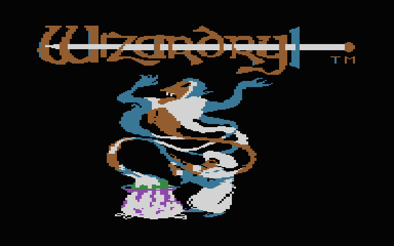
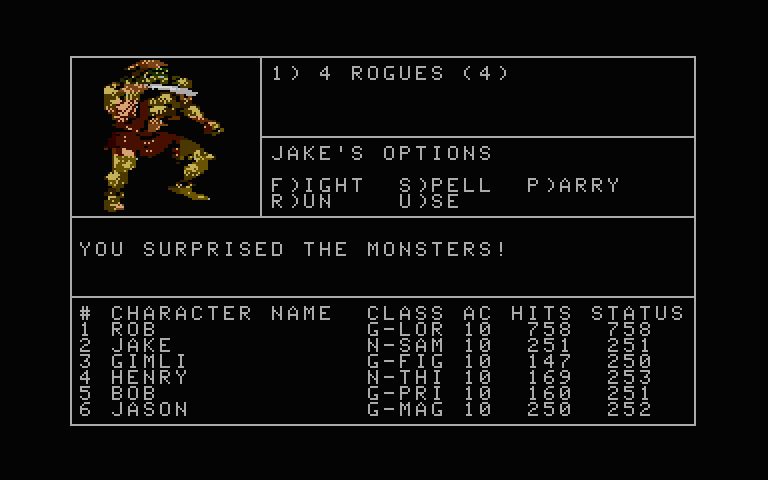

# Wizardry I for Atari 8-bit

An unofficial Atari XL/XE port of **Wizardry: Proving Grounds of the Mad Overlord**, targeting a 64 KB Atari 65XE. A new 6502 runtime runs the original Apple II game's Pascal p-code, with the animated title in colour, PC Engine monster pictures and NES music adapted for Atari POKEY.

## Screenshots

| Animated title | Monster encounter |
| --- | --- |
|  |  |

Watch [Wizardry 1 port to Atari 8bit](https://www.youtube.com/watch?v=1cHdtRZdmj8) on [grazzt519's YouTube channel](https://www.youtube.com/@grazzt519).

## Download: two disks with PCE pictures and music

Download both images:

- **[Disk 1 — Program](wizardry_disk1.atr)**: runtime, title, options and utilities. 59,792 bytes; it can be write-protected.
- **[Disk 2 — Scenario and saves](wizardry_disk2.atr)**: the game, scenario, all **95 PCE picture records**, **11 gameplay themes and four jingles**. 184,336 bytes; keep your play copy writable.

Both fit the **180 KB capacity budget per disk**, with 10,342 bytes free in Disk 2's body. Music starts at the castle after the swap to Disk 2; the two-disk title and options are silent. The display stays readable during loading. Compression waits for safe display intervals, so some loads take longer. [SHA-256 checksums](SHA256SUMS) are included for the four new images.

### Real hardware

**This two-disk version should now be playable on real 64 KB Atari XL/XE hardware with a compatible writable ATR-capable SIO device.** BASIC must be disabled; NTSC is the tested video mode. Disk access, swaps and saves have been tested in Atari800 with its fast SIO patch disabled. **Physical Atari operation has not yet been verified.**

The images use **128-byte logical sectors**: 467 sectors on Disk 1 and 1,440 on Disk 2. Your disk device must support that geometry and writes to Disk 2. Fitting the capacity budget does not establish physical-floppy compatibility: 1,440 × 128 is a different layout from a standard 40 × 18 × 256 double-density floppy. Check the drive and writing/conversion tool before transferring these images to physical media.

### Optional: start with a powerful party already formed

Use this matched pair for a quick start:

- **[Party Disk 1](wizardry_party_disk1.atr)** — 60,304 bytes.
- **[Party Disk 2](wizardry_party_disk2.atr)** — 184,336 bytes.

The castle opens with VANGUARD (Lord), RONIN (Samurai), SHADOW (Thief), DAWN (Priest), SAGE (Bishop) and MERLIN (Mage) already in the current party. Each has level 50, 999 HP, maximum attributes, 1,000,000 gold, all spells and nine casts at every spell level, with no equipment or passwords. Choose **E)dge → M)aze → L)eave camp** to start exploring.

### Existing single-image build

The older **[wizardry.atr](wizardry.atr)** remains available for emulators and devices supporting its oversized 3,801-sector image. Its two volumes switch automatically, so leave it mounted when the game asks for a boot or scenario disk. The new two-disk builds require actual swaps as described below.

## How to play the two-disk version

1. Keep the downloaded images as masters and make play copies, especially of Disk 2.
2. Select **800XL or 65XE / XL-XE**, **64 KB RAM**, **BASIC disabled** and **NTSC** in your emulator, or use the hardware setup above.
3. Boot Disk 1 in **D1:**. At the options screen after the title, press **S** to start.
4. At **CHANGE TO DISK 2 / PRESS ANY KEY WHEN READY**, replace D1 with the writable Disk 2, then press a key. The wrong disk prompts you to try again.
5. Press **RETURN** at the scenario prompts. In the normal build, create characters in the Training Grounds, assemble them at Gilgamesh's and shop at Boltac's. The party build has already assembled its six characters.

For Atari800:

```sh
atari800 -xl -ntsc -nobasic -no-kbdjoy0 -no-kbdjoy1 wizardry_disk1.atr
```

On Windows use `atari800.exe`. For the party build substitute `wizardry_party_disk1.atr`. In Atari800, **F1 → Disk Management** lets you replace the image in D1. In Altirra or other emulators, use the equivalent drive controls. Disable keyboard-to-joystick mappings so letter keys reach the game.

## Saves and Recover

**Characters and progress are saved in your writable Disk 2.** Keep that same file between sessions, flush any buffered emulator writes before closing, and back it up. Replacing Disk 2 with a fresh download replaces the save. When updating the program, you can keep your existing WZC3 Disk 2 and replace the corresponding Disk 1 from the same build type (normal or party).

Return to town before ending a session. The original game has no save-and-resume checkpoint inside the maze. If you reset while exploring and characters are marked **OUT**:

1. Boot Disk 1, choose **U)tilities → R)ecover**, and press **RETURN**.
2. At **PLACE SCENARIO IN DRIVE 1**, insert your saved Disk 2 and press **RETURN**.
3. After recovery, press **RETURN** and **L)eave**. At **PLACE BOOT DISK IN DRIVE 1**, insert Disk 1, press **RETURN**, then choose **S)tart** and swap to Disk 2 again when asked.

Recover returns interrupted expeditions to their state before entering the maze, without a ten-year ageing penalty. Dead or deliberately disbanded characters still need an in-game rescue. Automatic party formation preserves saved stats and does not revive or bring home unavailable characters.

## Current status

Development build, **October 13, 2026**. **All 50 tests pass**, including intermediate display frames during disk access, all picture records and music playback frames, disk swaps, wrong disks, Recover, automatic party formation, extended gameplay and byte-for-byte save comparisons. See [the validation log](src/test-artifacts/two-disk/tests.log) and [production smoke checks](src/test-artifacts/two-disk/production-smoke.log).

- A complete playthrough and PAL operation have not yet been verified.
- **M)ake scenario disk** and **U)pdate** require another drive and are unsupported; other utilities besides Recover remain untested. Start a fresh game from master disk copies.
- Each monster has its own picture, which can reveal its identity before the party identifies it.

## Source code and development

The [src/ folder](src/README.md) contains the runtime, build tools, tests and research documentation. Run development commands from `src/`. External Apple II disks, the NES NSF and optional PCE sprite assets must be supplied locally; they are excluded from the source tree. The ready-to-play ATR downloads are at the repository root.

```sh
cd src
python3 port/atari/build.py --disk2 --pictures monster
# Optional quick-start party:
python3 port/atari/build.py --disk2 --pictures monster --party --out wizardry_party.atr
```

See [build prerequisites](src/README.md#build-from-source) and [the detailed two-disk notes](src/port/atari/README.md#two-disk-build-with-pce-pictures).

## Credits

Original Wizardry by Andrew Greenberg and Robert Woodhead / Sir-Tech. Pascal and assembly reconstruction by Thomas William Ewers; restored scenario by Snafaru. NES music by Kentaro Haneda. Monster artwork uses Jun Suemi's designs as depicted in the PC Engine version. Compression uses Daniel Serpell's [ZX02](https://github.com/dmsc/zx02); upstream licences are included with the source.

Wizardry and the original game, music and artwork belong to their respective rights holders. This is an unofficial fan port.
